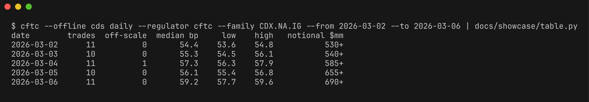

# cftc-rs

Read the credit default swap market's view of any company or index from the free DTCC public swap tape: any date range, typed trades, daily spread series, from Rust or the command line.



*Synthetic sample data (`docs/showcase/`). Day 3 contains one trade reported in percent instead of decimal; it is flagged off-scale and kept out of the level statistics.*

`cftc-rs` fetches and caches DTCC's public price dissemination (PPD) reports, turns their CSV rows into typed records, nets lifecycle corrections and cancellations, and exposes CDS prints and daily aggregates through a library and a CLI. Single-name CDS come from the SEC feed (Regulation SBSR); index CDS (CDX, iTraxx, CMBX) come from the CFTC feed (Part 43).

## Data terms

DTCC’s public data terms permit internal or personal use only (`internal_only`). Do not redistribute raw data or derived records, prints, or aggregates. This crate preserves the `internal_only` usage marker on every record, print, and daily aggregate. The crate reports disseminated values and does not calculate par spreads, hazard rates, or default probabilities.

The public PPD endpoint provides daily cumulative ZIP reports for SEC and CFTC asset classes. As of October 2026 the endpoint serves reports back to 2025-01-06 (SEC) and 2025-01-12 (CFTC). DTCC publishes every weekday, including market holidays; days without a report (weekends) are skipped. Downloads are cached locally.

Intraday slice ZIPs are available through `Client::slices`; published slices are cached permanently while the next slice number is probed live. `Client::ticker` reads the live, uncached ticker JSON endpoint.

## Install

Install the CLI:

```bash
cargo install --git https://github.com/davidawad/cftc-rs
```

To use the library from another Rust project, add the dependency in `Cargo.toml`:

```toml
cftc-rs = { git = "https://github.com/davidawad/cftc-rs", tag = "v0.1.0", default-features = false }
```

The library crate is named `cftc` and the installed command is `cftc`.

## CLI

All date ranges are inclusive. The cache defaults to the platform cache directory; set `CFTC_RS_CACHE` or pass the global `--cache-dir` option to change it. Use `--offline` to read only cached reports. The entity map for ticker lookup is a CSV with `scheme,id,ticker,lei,name` columns and can be set with `CFTC_RS_ENTITY_MAP` or `--map`.

```bash
# Fetch SEC and CFTC credit reports for a date range
cftc fetch --from 2025-05-01 --to 2025-05-09
cftc fetch --from 2025-05-01 --to 2025-05-09 --intraday

# Emit raw records as JSON Lines
cftc records --from 2025-05-01 --to 2025-05-09 --regulator sec --asset credits
cftc records --from 2025-05-01 --to 2025-05-09 --regulator sec --asset credits --intraday
cftc ticker --regulator sec --asset credits

# CDS daily aggregates for a CFTC index family
cftc cds daily --from 2025-05-01 --to 2025-05-09 --regulator cftc --family CDX.NA.IG --otr5y

# Distinct single-name reference entities
cftc cds underliers --from 2025-05-01 --to 2025-05-09 --regulator sec

# Individual CDS executions as JSON Lines
cftc cds prints --from 2025-05-01 --to 2025-05-09 --regulator cftc --kind index
```

Commands write result data to stdout and structured progress logs to stderr. Run `cftc --help` or `cftc cds --help` for all filters.

## Ticker mapping

Build an entity map from cached tape records and public registries:

```bash
cftc entities resolve --from 2025-05-01 --to 2025-05-09 [--tickers tickers.csv] [--out map.csv]
```

The optional ticker CSV has a `ticker` column (an `exchange` column may also be present); it filters resolved output. The resolver collects co-occurring ISIN and RED identifiers from cached tape records, looks up issuer LEIs and legal names with GLEIF, follows each issuer to its ultimate parent, then maps parent ISINs to equity tickers with OpenFIGI. It writes `scheme,id,ticker,lei,name,parent_lei,parent_name`; the existing `--map` reader continues to accept the original five columns. Registry responses are cached under the client cache directory's `entities` folder, and `--offline` only uses those cached responses. Uncached identifiers are warned and skipped.

GLEIF data is available under CC0. OpenFIGI's free service requires attribution to OpenFIGI; set `OPENFIGI_API_KEY` to use its authenticated limits. Keep in mind DTCC data and derived tape records remain subject to DTCC's internal or personal use terms described above.

## Rust library

```rust,no_run
use chrono::NaiveDate;
use cftc::{net_trades, AssetClass, Client, Query, Regulator};
use cftc::cds::{daily_series, CdsPrint};
use std::collections::BTreeSet;

let client = Client::new()?;
let from = NaiveDate::from_ymd_opt(2025, 5, 1).unwrap();
let to = NaiveDate::from_ymd_opt(2025, 5, 9).unwrap();
let query = Query::new(Regulator::Cftc, AssetClass::Credits, from, to);
let records = client.records(&query)?;
let trades = net_trades(records);
let prints: Vec<CdsPrint> = trades.iter().map(CdsPrint::from_trade).collect();
let days: BTreeSet<_> = query.reports().map(|report| report.date).collect();
let daily = daily_series(&prints, &days, from, to);
# Ok::<(), cftc::Error>(())
```

`Client::with_cache_dir(path).offline(true)` can be used for cache-only analysis. `Client::days(&query)` yields each available report day without collecting all records first.

## Disseminated value conventions

| Field or case | Interpretation |
| --- | --- |
| `Spread-Leg 1` with spread notation `3` | Decimal value; multiply by 10,000 for basis points (for example, `0.006` = 60 bp). |
| `CDX.NA.HY` / `CDX.EM` Spread-Leg 1, notation `3` | Price divided by 10,000; multiply by 10,000 to recover price points. |
| Spread-Leg 1 with notation `1` | Level as is (e.g. `CDX.EM` `95.52` = price 95.52). Seen alongside notation `3` for the same index on the same day. |
| Any other notation | Not interpreted: `index_quote` is empty. |
| `CMBX.*` | Price-quoted; the tape carries the upfront only, so `index_quote` is usually empty. `IBOXX` total-return rows are `Unknown`. |
| Off-scale prints | A print is flagged when its level is at least 10x (or at most 1/10) the median of five or more other same-day prints in its series for spread quotes and single names, or outside the 1.5x range for price quotes. `off_scale` and `suspected_cause` annotate the disseminated value; they never alter or remove it. Daily level statistics and carried levels exclude flagged prints. |
| Non-positive or non-finite levels | Any parsed level `<= 0`, `NaN`, or infinite is immediately flagged as `off_scale` with `suspected_cause = NonPositive`, including on thin days. These prints do not contribute to peer medians, daily level statistics, `last_level`, or `last_trade_date`; they count in `off_scale_trades`. |
| Upfront (`UFRO`) | Unsigned cash amount in source currency units, including accrued. No par-spread conversion is performed. |
| Capped notional | A trailing `+` marks a lower bound (for example, `5,000,000+`). |

## Development

```bash
cargo fmt
cargo clippy --all-targets -- -D warnings
cargo test
just ci
```

To regenerate the screenshot: `docs/showcase/make-screenshots.sh` (see `docs/showcase.md`).

## Sources

- DTCC Public Price Dissemination: https://pddata.dtcc.com/ppd/
- GLEIF LEI API: https://www.gleif.org/en/lei-data/gleif-api
- OpenFIGI API: https://www.openfigi.com/api/documentation

## License

GPL-3.0-or-later. See `LICENSE`. The license covers this code only; data you download with it stays under its providers' terms.
